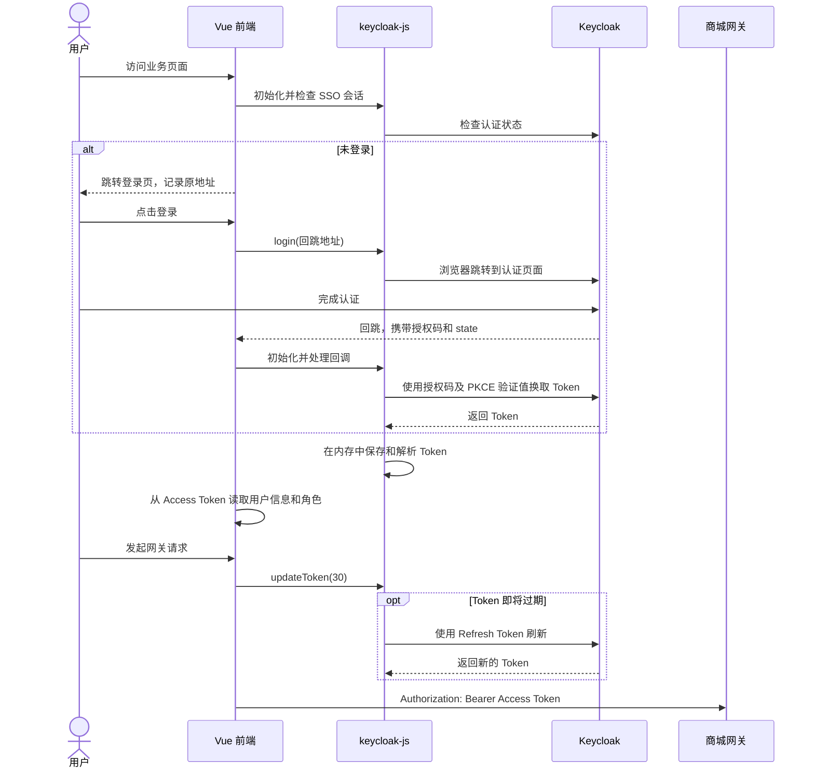

# 登录认证流程

本文说明 `mall-admin-vue` 当前的 Keycloak 登录、Token 管理和退出流程。具体会话时长、Token 内容和服务端版本以实际部署配置为准。

## 整体流程



## 初始化和登录

应用入口 [`src/main.ts`](../src/main.ts) 在挂载 Vue 之前等待 `initializeKeycloak()`。初始化失败时，页面显示错误，应用不继续挂载。

[`src/utils/keycloak.ts`](../src/utils/keycloak.ts) 创建 Keycloak 实例，并使用：

- `onLoad: 'check-sso'`：启动时检查已有 SSO 会话并处理认证回调。
- `pkceMethod: 'S256'`：授权码流程使用 PKCE S256。
- `checkLoginIframe: false`：关闭登录状态 iframe 检查。

[`src/router/guard/userLoginInfo.ts`](../src/router/guard/userLoginInfo.ts) 通过 `keycloak.authenticated` 判断登录状态。未登录访问非登录页时跳转 `/login`，并以 `redirect` 保存目标的完整路径；已登录访问登录页时跳转 `/gateway/services`。当前登录守卫只放行 `login` 路由，不根据 `meta.requiresAuth` 放行其他公开页面。

登录页 [`src/views/login/components/login-form.vue`](../src/views/login/components/login-form.vue) 调用 `userStore.login()`，最终调用 `keycloak.login()`。回跳路径只接受以 `/` 开头、不以 `//` 开头且不包含反斜杠的字符串，否则使用 `/gateway/services`。前端自身不收集用户名和密码。

### 回调和换取 Token

例如用户原本访问 `/gateway/services`，登录成功后浏览器可能回到：

```text
http://localhost:5173/gateway/services#state=<state>&session_state=<session>&iss=<issuer>&code=<authorization-code>
```

这是示意地址；具体参数取决于 Keycloak。当前没有指定 `responseMode`，适配器默认使用 fragment 模式。`state` 用于关联并校验登录请求，`code` 是授权码。适配器处理回调后，使用授权码、客户端 ID、回跳地址及 PKCE `code_verifier` 请求 Keycloak Token 端点，Token 从该 HTTP 响应取得；适配器通常会清理 URL 中的回调参数。不要将真实授权码或 Token 写进文档和日志。

## Token 和用户信息

| 数据 | 适配器属性 | 用途 |
| --- | --- | --- |
| Access Token | `keycloak.token` | 携带给网关，供服务端认证和授权 |
| Refresh Token | `keycloak.refreshToken` | 向 Keycloak 换取新的 Token |
| ID Token | `keycloak.idToken` | 向客户端提供认证身份信息 |
| 解析结果 | `tokenParsed`、`idTokenParsed` | 读取对应 Token 的 claims |
| 认证状态 | `keycloak.authenticated` | 前端登录状态判断 |

Token 由适配器保存在当前页面的 JavaScript 内存中；页面刷新后重新初始化，并尝试通过 Keycloak 会话恢复认证。当前源码不读写 `localStorage.access_token`：同一 origin 的本地存储可能包含旧项目或其他代码留下的数据，不能仅凭键名判断来源。`kc-callback-*` 等适配器临时数据和 Token 的内存保存方式是不同的。

Token 响应中的 `expires_in` 和 `refresh_expires_in` 单位为秒，分别表示本次签发的 Access Token 和 Refresh Token 有效时长；它们不是绝对时间。刷新结果和会话有效性还受 Keycloak 客户端及会话设置影响。

[`src/store/modules/user/index.ts`](../src/store/modules/user/index.ts) 从 **Access Token** 的 claims 填充 Pinia：名称依次取 `name`、`preferred_username`、`sub`；邮箱取 `email`；`accountId` 取 `sub`。它合并 realm 角色和当前客户端角色，包含 `admin` 时设为 `admin`，否则为 `user`。该过程没有额外调用用户信息接口。claims 是否存在取决于 Keycloak 的 scope 和 Mapper 配置。

登录后可在**个人中心 → 认证信息**（`/user/authentication`）查看状态、过期时间、解析结果以及按需显示的 Token 原文。页面的“更新显示”只重新读取适配器中的当前值，不主动刷新 Token。也可在浏览器 Network 中查看 Token 请求和网关请求头；Token 是凭证，避免将原文分享或上传到第三方解析网站。

## 请求和刷新

[`src/api/interceptor.ts`](../src/api/interceptor.ts) 对目标 origin 与 `VITE_API_BASE_URL` 的 origin 相同的 Axios 请求调用 `getValidAccessToken()`，并在有 Token 时设置：

```http
Authorization: Bearer <access-token>
```

不会把 ID Token 或 Refresh Token 作为业务请求的 Bearer Token。未认证时获取方法返回 `undefined`，请求本身仍可能继续发送，由服务端决定是否放行。

`getValidAccessToken()` 调用 `keycloak.updateToken(30)`：剩余有效期不足 30 秒时尝试刷新，否则使用现有 Access Token。实际触发刷新时由适配器使用 Refresh Token 请求 Keycloak；成功后按响应更新内存中的 Token。Refresh Token 是否轮换、旧值是否失效取决于服务端配置。

刷新失败时清除适配器 Token，发起登录跳转并以当前页面为回跳地址；`loginRedirectStarted` 避免并发失败重复发起跳转。当前业务请求失败，不会自动重放。项目没有定时刷新；仅停留在页面或浏览已加载的数据不一定会触发刷新。

响应拦截器收到 HTTP 401 或 403 时分别显示认证失败或无权限提示并抛出错误；401 本身不会自动触发刷新或重试。对于正常 HTTP 响应，业务 `code` 非 0 时显示错误并拒绝 Promise。

## 权限、网关和退出

登录守卫加载用户信息后，[权限守卫](../src/router/guard/permission.ts) 根据路由配置及前端角色判断页面访问；`roles: ['*']` 允许所有角色。默认配置 `menuFromServer: false`，使用本地路由；开启服务端菜单时会尝试加载菜单并校验目标路由。前端菜单和角色判断不能代替服务端授权。

网关对需认证请求验证 Bearer Token 的签名、时间、issuer 和 audience；项目网关当前尚未实现 API 级授权。后端只能可靠使用已验证 Token 中实际存在的 claims；下游业务服务是否收到并使用用户信息，取决于转发及自身认证配置。详见 [mall-gateway 文档](../../mall/mall-gateway/README.md)。

退出时 `userStore.logout()` 先重置 Pinia 用户信息、移除路由监听并清空服务端菜单，再调用 Keycloak logout，回跳站点根路径。根路径重定向到 `/gateway/services`；若认证状态已清除，守卫将用户带回登录页。

## Keycloak 配置与会话

开发环境使用 [`.env.development`](../.env.development) 中的 `VITE_KEYCLOAK_URL`、`VITE_KEYCLOAK_REALM`、`VITE_KEYCLOAK_CLIENT_ID` 和 `VITE_API_BASE_URL`。生产地址需在构建时配置，Vite 会将其写入构建产物。Keycloak 客户端需配置为公开客户端，启用标准流程和 PKCE S256，并配置有效的重定向 URI、注销后重定向 URI、Web Origins 和网关 audience；前端不应配置客户端密钥。

在 Keycloak 管理控制台选择 `mall` Realm，可在 **Realm settings → Tokens** 查看 Access Token Lifespan，在 **Realm settings → Sessions** 查看 SSO Session Idle 和 SSO Session Max；客户端 **Advanced** 中可能有覆盖项。界面名称与可用项因服务端版本而异。

| 设置 | 含义 | 示例起点 |
| --- | --- | --- |
| Access Token Lifespan | Access Token 有效期 | 10 分钟 |
| SSO Session Idle | 会话允许的空闲时间；成功刷新等活动可更新空闲时间 | 30 分钟 |
| SSO Session Max | 会话创建后的最长时间，不因刷新无限延长 | 8 小时 |

这些时间只是示例，应按业务风险配置。客户端会话限制也可能使会话更早结束。达到会话上限后，页面不一定立刻退出：已有 Access Token 可能在自身过期前仍被本地验证的网关接受；后续刷新失败时当前前端才发起重新登录。当前没有到期提醒和未保存表单保护。

## 排查顺序

1. 启动失败：检查浏览器是否能访问 Keycloak、环境变量是否在构建时正确设置，以及客户端重定向和跨域配置。
2. 登录回跳失败：检查 Network 中的授权和 Token 请求，确认回跳 URI、客户端、PKCE 及浏览器安全上下文。保留日志时避免泄露凭证。
3. 登录后请求 401：确认请求是否携带 Access Token，检查 Token 过期时间、issuer、audience 和网关配置。401 不会自动重试。
4. 刷新失败：检查 Token 请求响应、Refresh Token 和 SSO/客户端会话状态；检查用户是否长时间没有触发刷新。
5. 前端显示普通用户：检查 Access Token 中 realm 角色及当前客户端角色是否包含精确的 `admin`；前端显示角色并不等于网关 API 授权。
